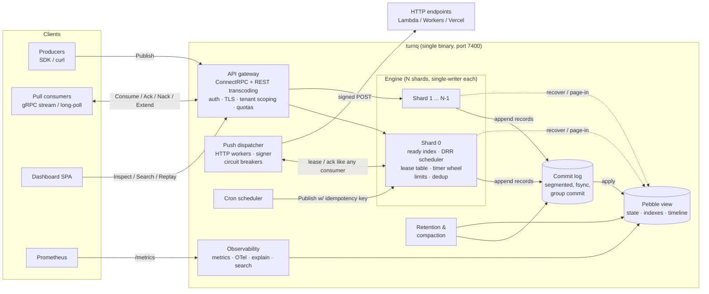
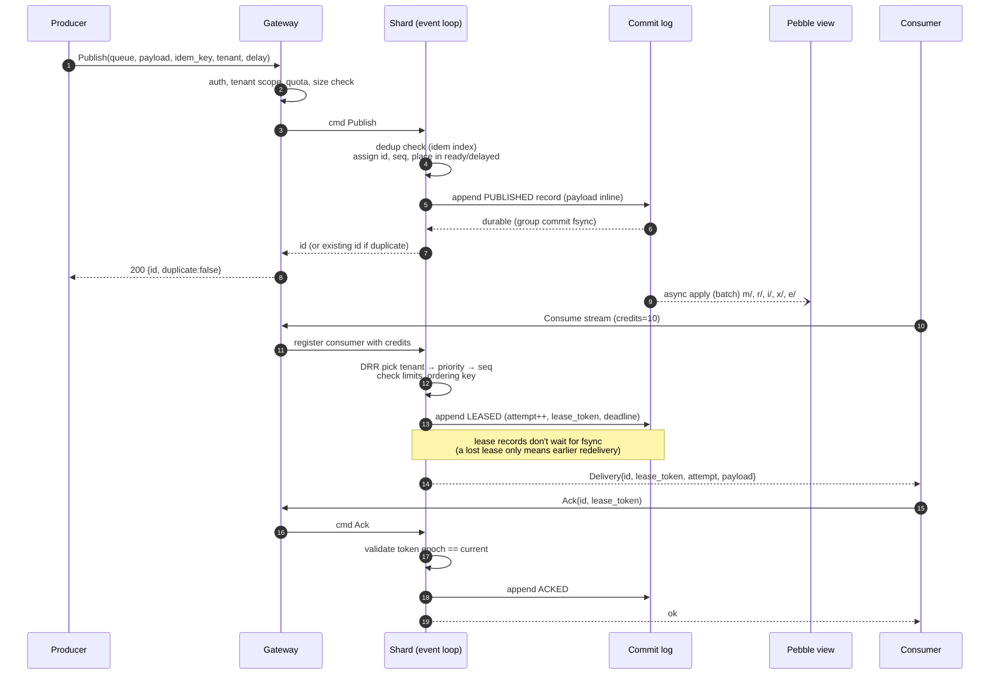

# 1. High-level architecture

## Component diagram

## Components and responsibilities

| Component | Responsibility | Notes |
|---|---|---|
| **API gateway** | ConnectRPC handlers (gRPC, gRPC-Web, Connect JSON), REST transcoding, TLS, API-key auth, tenant scoping, per-tenant publish quotas, request validation, routing to shard by queue. | Stateless. Also serves `/ui` (embedded SPA via `go:embed`), `/metrics`, `/healthz`, `/readyz`. |
| **Engine shard** | Owns a subset of queues (`hash(queue) % N`). Runs a single goroutine event loop that applies commands (publish, lease, ack, nack, extend, timer tick) to in-memory state, emits log records, and replies once the records are durable. | All scheduling logic lives here: DRR, priorities, ordering keys, concurrency and rate limits, delays, lease expiry, retries, DLQ. No locks. |
| **Commit log** | Append-only segmented log, the source of truth. Group commit with configurable fsync. Holds payloads and state transitions. | Becomes the Raft log in clustering. |
| **Pebble view** | Materialised state from the log: message records, ready/delayed/lease indexes, idempotency keys, secondary indexes, timeline events, config. WAL disabled, because the commit log *is* the WAL. | Rebuildable from the log (`turnq repair --rebuild-view`). |
| **Push dispatcher** | A built-in consumer: leases from queues bound to push subscriptions, POSTs signed requests, maps responses to ack/nack/retry, and enforces per-endpoint concurrency and circuit breakers. | Uses the same engine API as external consumers, so it gets no special-case semantics. |
| **Cron scheduler** | Computes the next fire per schedule and publishes with idempotency key `cron:{schedule}:{fire_ts}`, so a double-fire is deduplicated by construction. | Runs inside the shard that owns the target queue. That's leader-only in clustering. |
| **Observability** | Prometheus metrics, OTel spans, `Explain` ("why is this message not moving?"), search/filter (indexes + CEL scans), timeline queries. | Read path only. Never blocks shards. Reads Pebble snapshots. |
| **Retention & compaction** | Deletes expired terminal messages and events, reclaims log segments, relocates long-lived payloads out of old segments. | Background, rate-limited (IO budget). |

## Data flow: publish → consume → ack

### Durability per operation (why throughput survives the observability work)

| Operation | Waits for fsync? | If the broker crashes before fsync |
|---|---|---|
| Publish | **Yes** (per `fsync` policy) | Producer never got an ack and retries. The idempotency key deduplicates. |
| Lease | No | Message is redelivered sooner after restart. Attempt counter may be one lower. That's acceptable. |
| Ack | Configurable (`ack_durability: async\|sync`, default `async`) | Message is redelivered once. At-least-once holds. |
| Nack / retry scheduled | No | Same as lease loss. |
| Config changes, replay, redrive, purge | Yes | — |

Every record still goes through the same group-commit batch. "No" only means the reply doesn't wait for the fsync to finish.

## Threading model

- `N = GOMAXPROCS` shards by default (configurable, **fixed at data-dir creation**, because changing it means a reshard tool).
- Each shard has a bounded command channel (backpressure: when it's full, the gateway returns `RESOURCE_EXHAUSTED` with `retry-after`).
- One **log writer** goroutine collects records from all shards, group-commits (flushes when 1 ms passes or 256 KB is buffered, whichever comes first), fsyncs, and completes futures.
- One **view applier** goroutine applies committed records to Pebble in batches and advances `applied_index`.
- The view applier is behind the log by a few ms. Read-your-writes for inspection APIs works by waiting until `applied_index ≥ record_index` (the gateway passes a token). Shards never read the view on the hot path except to page in cold ready entries.

The engine takes `Clock`, `Rand` and `IO` interfaces so the whole broker can run under **deterministic simulation** (see [10](10-engineering.md)).

## Go vs Rust (challenged, Go kept)

| Factor | Go | Rust |
|---|---|---|
| Ecosystem for this exact product | gRPC/Connect, Pebble, Prometheus, OTel, cel-go, robfig/cron: all first-party quality | Good (tonic, fjall/rocksdb, opentelemetry), but more glue |
| Static single binary | Trivial with `CGO_ENABLED=0` | Trivial with musl |
| Tail latency | GC pauses are sub-ms with modern Go. Keep allocation off the hot path (pooled buffers, arena-style shard state). | Better and more predictable |
| Contributor pool for infra OSS | Very large (NATS, etcd, CockroachDB, Temporal) | Growing, smaller |
| **Embedding in Node/Python in-process** | Weak (`c-shared` brings a second runtime per process, signal-handling conflicts, large .so) | **Strong** (napi-rs, PyO3) |
| Velocity for a small team | High | Lower early on |

**Verdict:** Go, unless Q1 says true in-process embedding for non-Go languages is a must-have. In that case write the engine and storage core in Rust with thin bindings, and keep everything else the same. The sidecar approach in [06](06-embedded-mode.md) gives Node/Python 90% of the "SQLite of queues" experience with Go.

## Hard problems flagged at this level

- **Backpressure everywhere:** bounded shard channels, credit-based consumer flow control (server never pushes more than `credits`), disk high-watermark (90% → reject publishes, 95% → read-only), per-tenant queued-message/byte quotas.
- **Hot shard:** one very hot queue lives on one shard. Mitigation in v1 is **partitioned queues** (`partitions: 4` creates `q#0..q#3` on different shards, with the producer hashing on `ordering_key`/`tenant`). Fairness is then per partition. That's documented, not hidden.
- **Single writer vs fairness across shards:** DRR is per queue (per shard). Cross-queue tenant fairness (a tenant flooding queue A shouldn't starve tenant B on queue B) isn't needed, because those queues are scheduled independently.
