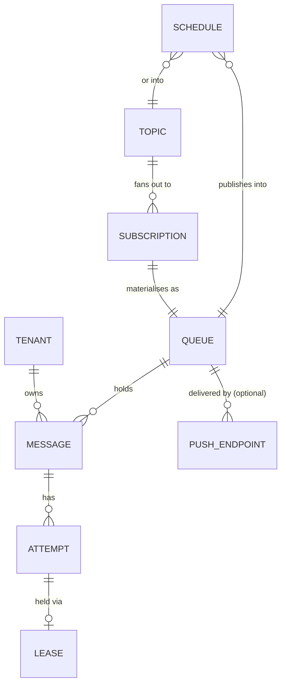
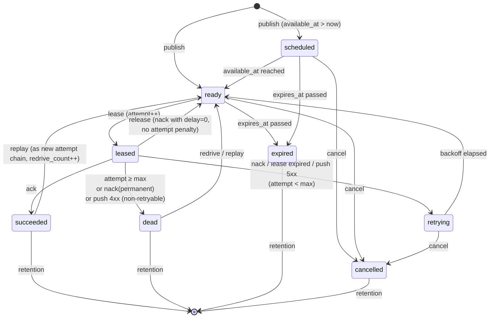

# 2. Core concepts and data model

There are seven nouns, and no exchanges, bindings, channels or vhosts.



## Concepts

### Queue
A named, durable work queue with competing consumers. All job semantics are queue-level config:

```yaml
name: emails
retry:
  max_attempts: 8
  backoff: { type: exponential, initial: 1s, max: 1h, multiplier: 2, jitter: full }
lease: { default: 30s, max: 12h }
dead_letter: { forward_to: emails.dlq }   # optional; DLQ is a *state* even without forwarding
dedup_window: 24h                          # idempotency key memory
max_payload_bytes: 1048576
retention: { succeeded: 3d, dead: 14d, timeline: full }   # full | failures | off
ordering: none                             # none | per_key
rate_limit: { per_second: 500, burst: 1000 }
key_limits:                                # concurrency/rate per arbitrary key
  - key_from: header:user_id               # or payload:$.user.id, or tenant
    max_in_flight: 2
    rate: { per_second: 5 }
fairness: { mode: drr, default_weight: 1, quantum: 1 }
indexed_fields: [ "$.order_id", "$.customer.email" ]   # ≤ 8, for search
partitions: 1
paused: false
```

### Topic
A named fan-out point. Publishing to a topic writes **one payload** to the log and creates one message record per subscription. Payload storage is shared, so fan-out to 10 subscriptions doesn't store 10 payloads.

### Subscription
Binds a topic to a destination queue, with an optional filter (CEL over headers/payload, e.g. `headers.type == "order.created"`). The destination queue can be auto-created (`orders.billing`). Pull consumers and push endpoints then attach to *that queue*.

> **Pull + push on the same queue = competing consumers.** If you want both a Lambda and a pull worker to each receive every message, create two subscriptions. This is explicit by design.

### Message
Immutable payload plus mutable delivery state.

| Field | Type | Notes |
|---|---|---|
| `id` | `msg_` + UUIDv7 (base32) | Time-sortable, globally unique, assigned by the broker |
| `queue` | string | |
| `tenant` | string | `_default` if unset. Max 128 bytes. |
| `payload` | bytes | Content-type in headers. JSON is first-class for search. |
| `headers` | map<string,string> | Includes `traceparent`/`tracestate` if propagated. Max 8 KB total. |
| `idempotency_key` | string? | Dedup within `dedup_window`, scoped per queue (or per topic) |
| `ordering_key` | string? | FIFO + single in-flight per key when `ordering: per_key` |
| `priority` | int 0–9 | Higher first, *within a tenant* (fairness first, then priority) |
| `available_at` | timestamp | Delay/schedule. `now` if unset. |
| `expires_at` | timestamp? | TTL. Expired messages go to state `expired`, not DLQ. |
| `state` | enum | See the state machine below |
| `attempt` | uint32 | Incremented at lease time |
| `max_attempts` | uint32? | Per-message override |
| `created_at`, `updated_at` | timestamp | |
| `last_error` | {code, message, consumer_id, at} | |
| `redrive_count` | uint32 | Incremented on DLQ redrive/replay |
| `source` | {kind: publish\|topic\|cron\|replay, ref} | For "where did this come from" |

### Lease
Exclusive, time-bounded right to process one attempt of a message.

```text
lease_token = base64( msg_id | attempt | lease_epoch | hmac(server_key, ...) )
```

- `lease_epoch` increments on **every** lease grant. Ack, nack and extend must present the current token. A stale token returns `FAILED_PRECONDITION: LEASE_EXPIRED`. This is the fix for the classic lease-expiry race (consumer A is slow, its lease expires, B takes the message, A acks late, and A's ack must not ack B's lease).
- `Extend(token, duration)` (heartbeat) is capped at `lease.max` from the *first* lease time, so a stuck consumer can't hold a message forever.
- Lease deadlines use the **monotonic clock** in memory. They're persisted as wall-clock times but re-armed from `now + remaining` on recovery.

### Attempt
Not a separate stored entity. It's derived from timeline events (`leased` → `acked|nacked|lease_expired`) and shown as rows in the dashboard: attempt #, consumer, started, duration, outcome, error.

### Tenant
A fairness, quota and authorization domain, inside queues and across the broker.

```yaml
tenant: acme
weight: 4                      # DRR share relative to others
max_in_flight: 50              # per queue, across consumers
rate: { per_second: 100 }      # publish and/or deliver
quota: { max_queued: 1_000_000, max_bytes: 2GiB }
```

Tenants are created implicitly on first publish with defaults. Explicit config only overrides those defaults.

### Schedule (cron)
```yaml
name: nightly-report
cron: "0 2 * * *"
timezone: Europe/Berlin
target: { queue: reports }       # or topic
payload: { "kind": "nightly" }
tenant: acme
misfire: fire_once               # skip | fire_once | fire_all (capped at 100)
overlap: allow                   # allow | skip_if_running (uses ordering_key = schedule name)
paused: false
```

## Message state machine



**Derived, non-persisted sub-states** (computed by `Explain`, shown in the UI), because "ready" alone hides why a message isn't moving:

| Shown as | Meaning |
|---|---|
| `ready · waiting for consumer` | No consumer with credits is connected |
| `ready · blocked by ordering key "user:42"` | Another message with that key is leased or retrying |
| `ready · key limit user_id=42 (2/2 in flight)` | Concurrency cap per key |
| `ready · tenant acme at max_in_flight (50/50)` | Tenant cap |
| `ready · rate limited until 12:00:01.250` | Queue, key or tenant token bucket |
| `ready · queue paused` | |
| `ready · push endpoint circuit open (until …)` | Push queues only |
| `leased · consumer w-7 · last heartbeat 41s ago · expires in 19s` | |

## Delivery guarantees

| Guarantee | Provided? |
|---|---|
| Durable after publish ack (per fsync policy) | Yes |
| At-least-once delivery | Yes |
| At most one *valid* lease per message at a time | Yes (lease epoch) |
| Deduplicated publish within window | Yes (idempotency key) |
| FIFO per queue | **Best effort only** (priority, fairness, delays and retries reorder by design) |
| FIFO per `ordering_key` | Yes, when `ordering: per_key`. Retries block the key until success or DLQ. |
| Exactly-once processing | No (see below) |

### Why not exactly-once in v1
1. **The broker can't see the consumer's side effects.** A consumer can charge a card and then crash before acking. No broker protocol prevents the redelivery without a transaction spanning the broker *and* the consumer's database.
2. Systems that claim EOS (Kafka transactions, Pulsar) only provide it **within their own storage** (read-process-write back into Kafka). For job queues whose side effects hit Postgres, Stripe or email, that doesn't help.
3. It costs a lot: two-phase coordination, fencing, transactional producers. That would double the complexity of the v1 core and halve throughput for a guarantee users would still misunderstand.
4. **What we do instead:** idempotent publish (dedup window), a stable `id` + `idempotency_key` + `attempt` delivered with every message, lease fencing tokens, and SDK helpers: an `inbox` table helper for Postgres/SQLite (`INSERT … ON CONFLICT DO NOTHING` keyed on message id in the *same transaction* as the side effect). That gives effectively-once processing where it can actually be guaranteed: in the consumer's own database.

## Hard parts flagged

- **Ordering vs retries:** with `ordering: per_key`, a poison message blocks its key until DLQ. That's the right call (no silent reordering), and the dashboard shows "key blocked by msg_X (attempt 5/8)".
- **Priority vs fairness:** priority applies within a tenant only. One tenant's priority 9 never jumps ahead of another tenant's fair share. Without this rule, priority becomes a fairness bypass.
- **Poison messages that crash consumers:** lease expiry counts as an attempt, so a message that kills its worker every time still reaches `dead` after `max_attempts`. The timeline shows `lease_expired` with no error, and that pattern gets flagged as a "suspected crash".
- **Dedup window semantics:** a duplicate within the window returns the *original* id with `duplicate: true`, even if the original has already succeeded. After the window, the key is forgotten. The window is measured from first publish, not from success.
