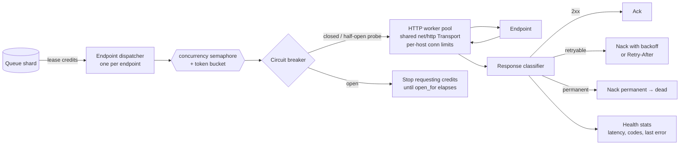

# 5. Push delivery over HTTP

## Model

A **push endpoint** attaches to a queue. The push dispatcher is a built-in consumer: it leases messages exactly like an SDK worker would, POSTs them, and acks or nacks based on the response. Retries, DLQ, fairness, ordering keys and key limits all come for free because they're queue semantics, not push semantics.

```yaml
push_endpoints:
  - name: billing-lambda
    queue: orders.billing
    url: https://abc.lambda-url.eu-west-1.on.aws/
    secret_ref: whsec_...            # generated if omitted; rotatable (two active secrets)
    timeout: 30s                     # also the lease duration for push
    max_concurrency: 20              # in-flight requests to this endpoint
    rate: { per_second: 50 }
    batch: { max_messages: 1 }       # >1 sends a JSON array (v0.5)
    headers: { "x-api-key": "secret:billing_api_key" }
    retry_on: [408, 429, 5xx, timeout, connect_error]
    fail_on: [400, 401, 403, 404, 410, 422]   # → dead immediately (configurable)
    circuit: { failure_ratio: 0.5, min_requests: 20, window: 30s, open_for: 30s }
```

## Dispatcher architecture



- Each endpoint dispatcher **only requests credits when it has a free concurrency slot and its circuit isn't open**. Backpressure is natural: an open circuit means messages stay `ready` (or are served to pull consumers on the same queue), and they don't burn attempts.
- Circuit **open does not consume attempts**. Messages aren't leased while it's open, so a 10-minute endpoint outage doesn't send everything to the DLQ. This is the single most important difference from naïve webhook retry loops.
- **Half-open:** one probe request at a time. Success → closed. Failure → open for 2× the previous duration (max 10 min).

## Request format

```http
POST /webhook HTTP/1.1
Host: abc.lambda-url.eu-west-1.on.aws
Content-Type: application/json
User-Agent: turnq/0.5 (+https://turnq.dev/push)
webhook-id: msg_01jdq3v8x7k2m9p4r6t8w0y2a4.3
webhook-timestamp: 1764064800
webhook-signature: v1,K5oZfzN95Z9UVu1EsfQmfVNQhnkZ2pj9o9NDN/H/pI4=
turnq-queue: orders.billing
turnq-tenant: acme
turnq-attempt: 3
turnq-message-id: msg_01jdq3v8x7k2m9p4r6t8w0y2a4
turnq-idempotency-key: order-9912
turnq-lease-token: lt_...            # for async completion (see below)
traceparent: 00-4bf92f3577b34da6a3ce929d0e0e4736-00f067aa0ba902b7-01

{"order_id": 9912, "amount": 4200}
```

The raw payload is the body by default. With `envelope: true`, the body is `{"id":…,"attempt":…,"headers":{…},"payload":…}`.

## Signing scheme: Standard Webhooks

```text
signed_content = webhook-id + "." + webhook-timestamp + "." + raw_body
signature      = base64( HMAC-SHA256( secret_bytes, signed_content ) )
header         = "v1," + signature   (space-separated list during secret rotation)
```

- `webhook-id` = `{message_id}.{attempt}`. Receivers dedupe on `turnq-message-id` and use `webhook-id` for replay protection.
- Receivers must reject timestamps more than 5 min off (replay window).
- **Rotation:** two secrets can be active at once, and both signatures are sent during the overlap.
- Why Standard Webhooks: verifier libraries already exist for Node, Python, Go, Ruby, PHP, Java, Rust, C# and Elixir. We ship `turnq.verifyWebhook()` helpers that wrap the spec anyway.
- **Optional (v1.0):** asymmetric `v1a` (Ed25519) signatures for receivers that shouldn't hold a shared secret.

## Response handling

| Response | Action | Counts as attempt? |
|---|---|---|
| 2xx | Ack | — |
| 202 + header `turnq-async: true` | **Async completion:** keep the lease open (extendable). The receiver later calls `POST /v1/leases/{token}:ack` or `:nack`. For Lambda jobs longer than the HTTP timeout. | — |
| 408, 429, 502, 503, 504 | Retry. Honour `Retry-After` (seconds or HTTP date), clamped to `[1s, 1h]`. 429/503 also feed the endpoint's rate limiter (adaptive slowdown: halve rate, then additive increase). | Yes |
| Other 5xx, timeout, connection error, TLS error | Retry with queue backoff. Feeds the circuit breaker. | Yes |
| 400, 401, 403, 404, 410, 422 | **Permanent** → `dead` with `last_error = {http_status, body[0:4KiB]}`. 410 also auto-disables the endpoint (configurable). | Yes |
| 3xx | Not followed (SSRF safety). Treated as permanent with a clear error. | Yes |

The response body (first 4 KiB) and headers are stored on the attempt event. This answers "what did the endpoint actually say?", which is the #1 webhook debugging question.

## Retry policy

Queue-level backoff applies (default exponential 1s → 1h, full jitter, 8 attempts):

```text
delay(attempt) = random(0, min(max, initial * multiplier^(attempt-1)))   // full jitter
```

Full jitter is the default because synchronised retries from a recovering endpoint are the classic thundering herd.

## Endpoint health (dashboard + API)

Per endpoint: success rate (1m/15m/1h), p50/p95/p99 latency, response code histogram, circuit state + history, current concurrency vs limit, last 100 deliveries (code, latency, error snippet), backlog age of oldest ready message, and auto-disabled reason.

## Security

- **SSRF protection (on by default):** resolve the DNS name, then **block private, loopback, link-local, metadata (169.254.169.254, fd00:ec2::254) and CGNAT ranges** at dial time via a custom `net.Dialer.Control`. Checking at dial time defeats DNS rebinding. Override per endpoint with `allow_private_networks: true` (an admin-only permission).
- HTTPS required unless `allow_insecure: true`.
- Secrets are stored encrypted with a server key (`TURNQ_SECRET_KEY` env or KMS file) and never returned by the API after creation.
- Per-tenant endpoints: tenants with scoped API keys can only register endpoints on queues they own.

## Serverless notes

| Platform | Notes |
|---|---|
| AWS Lambda (function URL / API GW) | Set `timeout` ≤ the function timeout. Use async completion for jobs > 29 s behind API Gateway. |
| Cloudflare Workers | Very fast. Set `max_concurrency` high (100+). Workers time limits make async completion the norm for heavy jobs. |
| Vercel functions | Cold starts: per-endpoint `timeout` default 30s. Optional `warmup` probe (HEAD) when the circuit closes. |

## Hard parts flagged

- **Timeout ≠ failure.** A timeout means the receiver may have processed the request. Retrying is correct under at-least-once, but receivers *must* dedupe on `turnq-message-id`. The docs and verifier helpers make this the default path.
- **Slow endpoint + high concurrency = lease exhaustion.** Push leases equal `timeout` plus a margin, and the dispatcher cancels the HTTP request at lease deadline minus 1 s so a late 2xx never races a re-lease.
- **Ordering keys with push**: work, but one slow endpoint call blocks the key for up to `timeout`.
