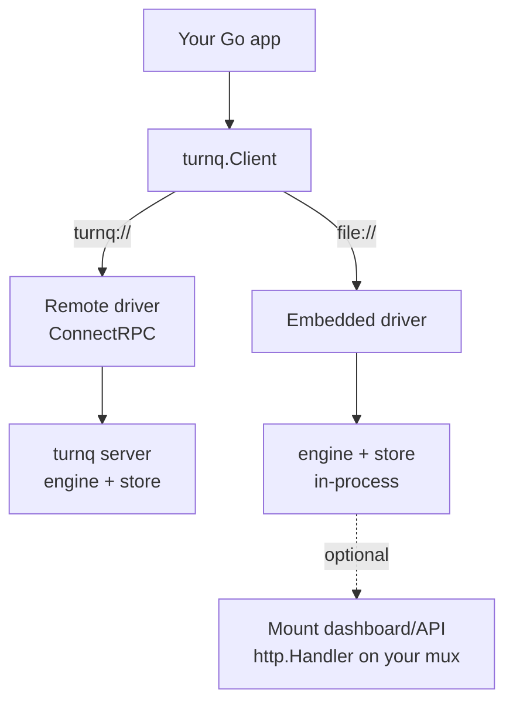

# 6. Embedded vs server mode

## The shared abstraction

There is one interface. Which driver sits behind it is decided by the connection string, as with `database/sql`.

```go
package turnq   // github.com/turnq/turnq/sdk/go  (lightweight; no storage deps)

type Client interface {
    Publish(ctx context.Context, queue string, payload any, opts ...PublishOption) (PublishResult, error)
    PublishTopic(ctx context.Context, topic string, payload any, opts ...PublishOption) (PublishResult, error)
    Worker(queue string, handler Handler, opts ...WorkerOption) *Worker
    Lease(ctx context.Context, queue string, n int, opts ...LeaseOption) ([]*Delivery, error) // low-level
    Admin() Admin          // queues, topics, subscriptions, schedules, tenants, push endpoints
    Inspect() Inspector    // get, search, timeline, explain, replay, redrive
    Close() error
}

func Open(dsn string, opts ...Option) (Client, error)
```

| DSN | Driver | Package |
|---|---|---|
| `turnq://host:7400?tls=true` / `turnqs://…` | Remote (ConnectRPC) | built into `sdk/go` |
| `file://./data` | **Embedded engine** | `import _ "github.com/turnq/turnq/embedded"` (registers the driver, pulls in Pebble) |
| `mem://` | Embedded engine + `memstore` | same |
| `local:./data` | Spawn/attach to a managed sidecar (non-Go SDKs) | Node/Python SDKs |

The embedded driver wraps **the same `internal/engine` + `internal/store`** the server uses. There's no separate implementation that could drift. The remote driver and the embedded driver run the same SDK conformance test suite (`sdk/conformance`), which is a black-box behavioural spec run against both.



## Non-Go languages: managed sidecar ("local mode")

Go can't be embedded cleanly into Node or Python (see [01](01-architecture.md#go-vs-rust-challenged-go-kept)). So:

- npm `turnq` ships per-platform binaries as `optionalDependencies` (`@turnq/bin-linux-x64`, `-darwin-arm64`, …), the same approach esbuild uses. Python wheels bundle the binary per platform.
- `connect("local:./data")` → the SDK takes a lock in `./data/LOCK.sidecar`. It reuses a running sidecar if one is alive (shared by app replicas on the same host), otherwise it spawns `turnq server --data ./data --listen unix:./data/turnq.sock --parent-pid <pid>`.
- The sidecar exits when no clients have been connected for 60 s (or when the parent dies), unless `--persist` is set.
- The result is zero-config, survives app restarts, has the same on-disk format, and the same semantics.

## What changes in embedded mode

| Feature | Server | Embedded (Go in-process) | Notes |
|---|---|---|---|
| Publish/consume/ack/retries/delays/cron/DLQ/fairness | ✅ | ✅ | Identical engine |
| Idempotency, ordering keys, key limits | ✅ | ✅ | |
| Push delivery | ✅ | ✅ | The dispatcher runs in your process (it uses your process's egress) |
| Durability | fsync policy | same | Default `fsync=always`. `interval` is reasonable for dev. |
| **Multi-process access** to one data dir | n/a | ❌ **single process** (`LOCK`) | Unlike SQLite. Use the sidecar or a server for multiple processes. |
| Dashboard | `/ui` | Opt-in: `http.Handle("/turnq/", turnq.DashboardHandler(c))` | |
| Metrics | `/metrics` | Registers into your Prometheus registry if provided | |
| Auth / TLS / API keys | ✅ | ❌ not applicable (in-process trust) | Tenants still exist for fairness and quotas |
| Consumers in other processes | ✅ | ❌ unless you `ServeAPI()` | `c.ServeAPI(":7400")` turns the embedded engine into a server |
| Clustering (future) | ✅ | ❌ | |
| Memory/CPU | dedicated | shares your process | Engine goroutines are bounded (shards = 2 by default when embedded) |
| Lifecycle | daemon | `Close()` must be called | On an unclean exit, leases survive and messages are redelivered after lease expiry |

### Graceful degradation rules
- APIs that make no sense embedded (e.g. `Admin().CreateAPIKey`) return `ErrUnsupportedInMode`, so they fail explicitly and never silently do nothing.
- Every feature that *exists* in both modes has identical semantics. That's enforced by the conformance suite. Any difference is a bug.

## Migration: embedded → server

**Path 1: move the directory (offline, recommended).** The on-disk format is identical (`TURNQ_FORMAT` records the shard count, and the server adopts it).

```bash
# stop your app (releases LOCK)
rsync -a ./data/ server:/var/lib/turnq/
turnq server --data /var/lib/turnq    # all messages, leases, history intact
# change DSN: file://./data → turnq://server:7400 ; deploy
```

Leases held by the old embedded workers expire naturally and are redelivered (at-least-once).

**Path 2: online drain-and-copy (no downtime).**

```bash
turnq migrate --from file://./data --to turnq://server:7400 \
  --mode live --include-history=false
```

1. Copies config (queues, topics, subscriptions, schedules, tenants).
2. Pauses **schedules** on the source (prevents double-fire), then enables them on the target. Cron idempotency keys (`cron:{name}:{fire_ts}`) make a duplicate fire harmless anyway.
3. Streams all `ready`/`scheduled`/`retrying`/`dead` messages, preserving `id`, `attempt`, `available_at`, `idempotency_key`, and the dedup index entries still within their window.
4. In-flight (`leased`) messages are left on the source to finish. The app switches DSN, the source drains, and `migrate --finalize` copies any leftovers (nacked/expired).
5. Optionally copies history (`--include-history`): terminal messages and timelines.

**Server → embedded** works the same way in reverse (useful for local repros: "pull the DLQ from prod into my laptop", with payload redaction rules).

**To/from Postgres store:** `turnq migrate --from file://./data --to postgres://…` uses the same mechanism, since it's just another `Store`.
