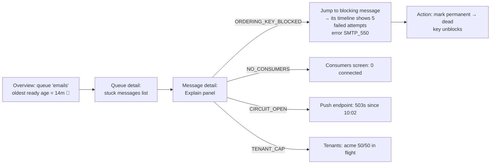

# 9. Dashboard

**Tech:** React + Vite + TanStack Query/Table, built into `web/dashboard/dist` and embedded with `go:embed`. It's served at `/ui`, talks only to the public API through the Connect-Web client (so it gets no private endpoints, and anything the UI can do, the API can too), and authenticates via API key or OIDC (v1.0). Live updates use server-streaming `Watch*` RPCs (v0.5). In v0.1 it polls every 2 s.

**Design rule:** every screen answers a question an on-call engineer actually asks. Every message id anywhere is a link to Message detail.

| # | Screen | Questions it answers | Key elements |
|---|---|---|---|
| 1 | **Overview** | Is anything on fire right now? | Publish/ack/nack rates, oldest-ready-age per queue (the best "stuck" signal), DLQ growth, failing push endpoints, disk usage, top 5 noisy tenants |
| 2 | **Queues** | Which queues are unhealthy? | Table: ready, in-flight, retrying, dead, oldest age, rates, consumers. Sparklines. Sort by "oldest ready age". Pause/resume. |
| 3 | **Queue detail** | What's happening in *this* queue and why? | State breakdown, rate charts (1-min buckets from `ts/`), consumers (id, credits, in-flight, last seen), config with an edit diff, top errors grouped by `last_error.code`, a **"stuck messages"** list (ready > N min), tenants tab |
| 4 | **Message explorer** | Find the message for order 9912 / user X / idempotency key Y | Search box accepting id, idempotency key, `field:value` for indexed fields, and a CEL filter. Faceted filters: state, tenant, time range. Bulk actions on the result set: replay, cancel, redrive. A "Copy as curl" / "Copy as CLI" button for every search. |
| 5 | **Message detail** | **Why is this message stuck? What happened to it?** | Header: state badge + **Explain panel** (ranked reasons with countdowns: "blocked by ordering key user:42 held by msg_X (attempt 5/8) – next try in 2m"). **Timeline**: vertical event list with attempt grouping, consumer, duration, error and HTTP response snippet. Payload/headers viewer (JSON tree, redaction rules applied, a `payload:read` scope is needed to reveal). Actions: replay, cancel, edit-and-replay (v0.5), copy id. Trace link (if `traceparent` is set and a trace UI URL is configured). |
| 6 | **Dead letters** | What's failing, why, and can I safely redrive? | Grouped by error code / HTTP status / consumer, with counts and first/last seen. Select a group → dry-run redrive (shows the count) → redrive with spread. Redrive history. |
| 7 | **Tenants (fairness)** | Is one customer starving the others? Is fairness working? | Per queue: tenants with weight, fair share vs **actual delivered share** (5 min), ready, in-flight/cap, oldest age, parked reason. A "noisy tenant" highlight when their backlog is above 10× the median. Inline edit of weight/caps. |
| 8 | **Push endpoints** | Is my Lambda/Worker healthy? What did it respond? | Success rate, latency percentiles, code histogram, circuit state timeline, last 100 deliveries with status and body snippet, secret rotation, "send test delivery" |
| 9 | **Schedules** | Did the nightly job fire? When's the next one? | Cron, timezone, next 5 fire times (DST-aware preview), last fires with links to the produced messages and their outcome, misfires, pause/trigger now |
| 10 | **Consumers** | Who is connected and are they keeping up? | Consumer id, queue, SDK/version, credits, in-flight, ack rate, avg processing time, last heartbeat, suspected-crash flags (lease expiries with no nack) |
| 11 | **Settings** | Who can do what? | API keys (scopes, queue/tenant restrictions, last used), retention policies, redaction rules, server info and build |

## The "why is it stuck?" flow (primary UX path)

## Non-goals for the dashboard
- No log aggregation or arbitrary charting. Link out to Grafana. We ship a Grafana dashboard JSON in `deploy/grafana/`.
- No config-as-UI drift: edits in the UI produce the equivalent `turnq apply` YAML diff and show it before saving.
